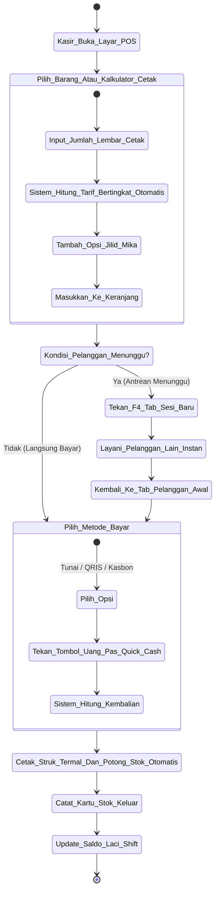
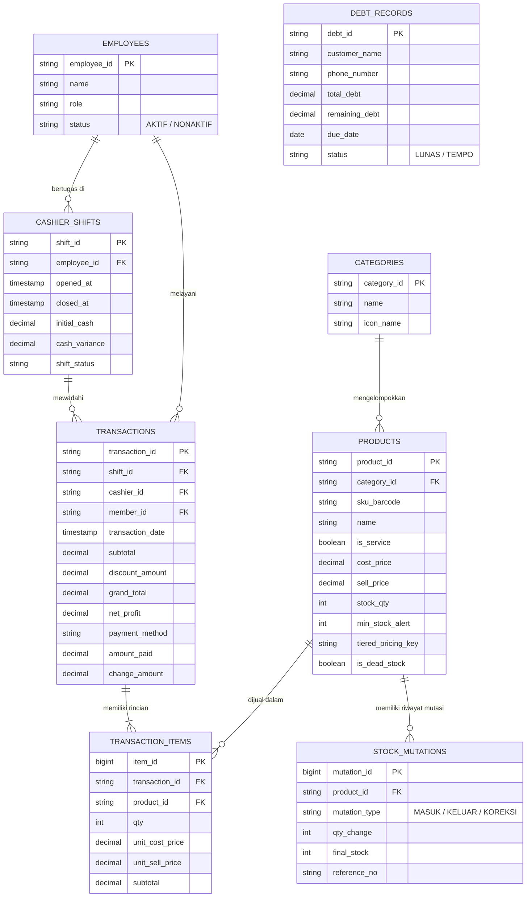

# LAPORAN LENGKAP PROYEK UAS SISTEM INFORMASI MANAJEMEN (SIM)
# PERANCANGAN SISTEM INFORMASI KASIR & MANAJEMEN RITEL PINTAR "COPY STAR KUBU" BERBASIS WEB

```
                         UNIVERSITAS BINA SARANA INFORMATIKA
                                   FAKULTAS TEKNIK & INFORMATIKA
                        PROGRAM STUDI SISTEM INFORMASI / TEKNIK INFORMATIKA
                                            2026
```

---

## HALAMAN JUDUL

**TUGAS BESAR / PROYEK AKHIR SEMESTER (UAS)**
**MATA KULIAH : SISTEM INFORMASI MANAJEMEN (SIM)**

**JUDUL PROYEK:**
**"PERANCANGAN DAN IMPLEMENTASI SISTEM INFORMASI KASIR DAN MANAJEMEN RITEL PINTAR 'COPY STAR KUBU' BERBASIS WEB UNTUK OPTIMALISASI PELAYANAN JASA CETAK DAN PENGENDALIAN PERSEDIAAN"**

* **Disusun Oleh:** Kelompok Mahasiswa UBSI
* **Nama Unit Usaha Mitra:** COPY STAR KUBU
* **Pemilik Mitra (Owner):** Theodorus Eldian
* **Lokasi Usaha:** Jln. Soeparto 1 Kubu, Desa Kubu, Kec. Kubu, Kab. Kubu Raya, Kalimantan Barat
* **Dosen Pengampu:** Dosen Pengampu Mata Kuliah Sistem Informasi Manajemen
* **Tahun Akademik:** 2025/2026

---

## KATA PENGANTAR

Puji syukur kami panjatkan ke hadirat Tuhan Yang Maha Esa, karena atas rahmat dan karunia-Nya, penyusunan Laporan Proyek Akhir Semester (UAS) untuk mata kuliah **Sistem Informasi Manajemen (SIM)** dengan judul **"Perancangan dan Implementasi Sistem Informasi Kasir dan Manajemen Ritel Pintar 'COPY STAR KUBU' Berbasis Web"** dapat diselesaikan dengan baik dan tepat waktu.

Laporan ini disusun sebagai salah satu syarat penilaian kelulusan pada mata kuliah Sistem Informasi Manajemen di Program Studi Fakultas Teknik dan Informatika, Universitas Bina Sarana Informatika (UBSI). Dalam penyusunan laporan dan pengembangan perangkat lunak ini, penulis mengintegrasikan teori-teori manajemen operasional, sistem pendukung keputusan (*Decision Support System*), serta rekayasa perangkat lunak web modern guna menyelesaikan permasalahan nyata pada unit usaha ritel dan jasa fotokopi "COPY STAR KUBU".

Penulis menyadari bahwa keberhasilan penyusunan laporan ini tidak lepas dari bimbingan, arahan, dan dukungan berbagai pihak. Oleh karena itu, penulis ingin menyampaikan rasa terima kasih yang sebesar-besarnya kepada:
1. Rektor dan segenap pimpinan civitas akademika Universitas Bina Sarana Informatika (UBSI).
2. Dosen Pengampu Mata Kuliah Sistem Informasi Manajemen yang telah memberikan arahan keilmuan, bimbingan, dan evaluasi selama perkuliahan.
3. Bapak Theodorus Eldian selaku pemilik (*Owner*) unit usaha COPY STAR KUBU yang telah memberikan izin observasi, data operasional, serta masukan kebutuhan sistem di lapangan.
4. Rekan-rekan satu kelompok mahasiswa yang telah bekerja sama dan berkontribusi secara solid dari tahap analisis, pengkodean web, hingga perampungan laporan ini.
5. Orang tua dan keluarga tercinta yang senantiasa memberikan doa restu dan dorongan moril maupun materiil.

Penulis menyadari bahwa laporan ini masih memiliki keterbatasan. Oleh karena itu, kritik dan saran yang membangun sangat diharapkan demi penyempurnaan di masa mendatang. Semoga laporan ini dapat memberikan manfaat nyata bagi pengembangan unit usaha COPY STAR KUBU serta menjadi referensi akademis yang berguna bagi pembaca.

Kubu Raya, Oktober 2026

**Tim Penyusun Proyek UAS**

---

## DAFTAR ISI

* **HALAMAN JUDUL**
* **KATA PENGANTAR**
* **DAFTAR ISI**
* **DAFTAR GAMBAR**
* **DAFTAR TABEL**
* **BAB I: PENDAHULUAN**
  * 1.1 Latar Belakang Masalah
  * 1.2 Identifikasi Masalah
  * 1.3 Rumusan Masalah
  * 1.4 Ruang Lingkup Masalah
  * 1.5 Tujuan dan Manfaat Penelitian
* **BAB II: LANDASAN TEORI & TINJAUAN PUSTAKA**
  * 2.1 Konsep Dasar Sistem
    * 2.1.1 Pengertian Sistem
    * 2.1.2 Karakteristik Sistem
    * 2.1.3 Klasifikasi Sistem
  * 2.2 Konsep Dasar Informasi
    * 2.2.1 Pengertian Informasi
    * 2.2.2 Kualitas dan Nilai Informasi
    * 2.2.3 Siklus Pengolahan Informasi
  * 2.3 Konsep Sistem Informasi Manajemen (SIM)
    * 2.3.1 Pengertian Sistem Informasi Manajemen
    * 2.3.2 Peran SIM dalam Hirarki Keputusan Bisnis Ritel
  * 2.4 Sistem Penjualan Kasir (*Point of Sale*) dan Pengendalian Persediaan
    * 2.4.1 Sistem Point of Sale (POS)
    * 2.4.2 Manajemen Mutasi Persediaan (*Stock Ledger*)
    * 2.4.3 Strategi Penetapan Harga Bertingkat (*Tiered Pricing*)
  * 2.5 Perangkat Lunak dan Teknologi Pengembangan Berbasis Web
    * 2.5.1 HTML5 dan Semantik Dokumen
    * 2.5.2 CSS3 Modern Glassmorphism
    * 2.5.3 JavaScript ES6+ State Machine
    * 2.5.4 LocalStorage Persistent Architecture
    * 2.5.5 Basis Data Relasional SQL
  * 2.6 Tinjauan Pustaka / Penelitian Terdahulu
* **BAB III: ANALISIS DAN PEMBAHASAN SISTEM**
  * 3.1 Profil dan Gambaran Umum Unit Usaha Mitra
    * 3.1.1 Sejarah dan Profil Usaha COPY STAR KUBU
    * 3.1.2 Visi dan Misi Usaha
    * 3.1.3 Struktur Organisasi dan Uraian Tugas
  * 3.2 Analisis Sistem Berjalan dan Permasalahannya
    * 3.2.1 Prosedur Sistem Berjalan (Alur Manual)
    * 3.2.2 Analisis Kelemahan Sistem Berjalan (PIECES Framework)
  * 3.3 Analisis Kebutuhan Sistem Usulan
    * 3.3.1 Kebutuhan Fungsional (*Functional Requirements*)
    * 3.3.2 Kebutuhan Non-Fungsional (*Non-Functional Requirements*)
  * 3.4 Perancangan Sistem Usulan
    * 3.4.1 Use Case Diagram dan Skenario
    * 3.4.2 Activity Diagram Sistem
    * 3.4.3 Entity Relationship Diagram (ERD) dan Logical Record Structure (LRS)
    * 3.4.4 Spesifikasi File dan Kamus Data
  * 3.5 Perancangan Antarmuka Pengguna (*User Interface*)
    * 3.5.1 Antarmuka Kasir Layar Tunggal (*Single Screen POS*)
    * 3.5.2 Modul Kalkulator Fotokopi dan Cetak Bertingkat
    * 3.5.3 Modul Buku Kasbon dan Piutang Warga Ritel Desa
    * 3.5.4 Modul Portal Antrean WhatsApp Pelanggan dan Studio Foto Kilat
    * 3.5.5 Modul Dashboard Analitik Pemilik (*Owner*) dan StarBot AI
  * 3.6 Pengujian Sistem (*Black Box Testing*)
* **BAB IV: PENUTUP**
  * 4.1 Kesimpulan
  * 4.2 Saran Pengembangan
* **DAFTAR PUSTAKA (Style APA 6th Edition)**
* **LAMPIRAN**

---

# BAB I: PENDAHULUAN

### 1.1 Latar Belakang Masalah
Perkembangan teknologi informasi dan komunikasi saat ini telah mendorong transformasi fundamental dalam tata kelola operasional berbagai sektor usaha, termasuk usaha mikro, kecil, dan menengah (UMKM) di bidang ritel dan jasa (Laudon & Laudon, 2018). Usaha ritel modern dituntut untuk menyajikan proses transaksi yang cepat, akurat, serta mampu menyediakan data terintegrasi yang dapat mendukung pimpinan dalam proses pengambilan keputusan strategis (*Decision Support System*) (O'Brien & Marakas, 2011).

COPY STAR KUBU merupakan unit usaha ritel yang berlokasi di Jalan Soeparto 1 Kubu, Desa Kubu, Kecamatan Kubu Raya, Kalimantan Barat, yang bergerak dalam bidang penyediaan jasa *digital photocopy*, cetak foto kilat (*photo printing*), penjilidan dokumen, serta penjualan Alat Tulis Kantor (ATK). Berbeda dengan minimarket konvensional yang hanya menjual barang dagangan fisik berkode batang (*barcode*), unit usaha fotokopi dan ATK memiliki karakteristik operasional yang sangat kompleks dan dinamis (Kadir, 2014):

1. **Perhitungan Tarif Jasa Bertingkat (*Tiered Pricing*):** Layanan fotokopi dan cetak dokumen menerapkan harga berjenjang berdasarkan kuantitas pesanan. Pada mekanisme manual saat ini, kasir menghitung nominal biaya menggunakan kalkulator konvensional yang memakan waktu dan berisiko tinggi menimbulkan selisih salah hitung.
2. **Kondisi Antrean Beririsan (*Concurrent Queue*):** Dalam operasional sehari-hari, sering kali terjadi situasi di mana seorang pelanggan sedang menunggu proses cetak berkas puluhan lembar, sementara pelanggan lain di antrean belakang hanya ingin membeli satu produk alat tulis sederhana. Ketiadaan sistem multi-sesi kasir (*multi-tab*) memaksa kasir menunda pelanggan berikutnya atau menghapus draft transaksi yang sedang berlangsung.
3. **Pengelolaan Stok Barang Varian Tinggi (*High-Variant Inventory*):** Toko ATK memiliki ratusan jenis varian barang berukuran kecil (kertas, pena, map, binder). Sistem pencatatan manual sering memicu terjadinya *dead stock* (barang mengendap tanpa perputaran) serta kekosongan persediaan mendadak (*stockout*) pada komoditas utama tanpa peringatan dini.
4. **Karakteristik Pembukuan Kasbon / Piutang Warga Ritel Desa:** Di wilayah pedesaan dan instansi lokal, transaksi tempo/kasbon merupakan hal lumrah. Ketiadaan pencatatan piutang digital terstruktur menimbulkan risiko piutang tak tertagih dan kesulitan rekonsiliasi kas.
5. **Keterbatasan Informasi untuk Pengambilan Keputusan Pemilik (*Owner*):** Pemilik usaha kesulitan menganalisis tren omzet harian, margin laba bersih riil, serta jam-jam sibuk (*peak hours*) karena data transaksi tercecer dalam nota kertas konvensional.

Berdasarkan permasalahan tersebut, dibutuhkan sebuah **Sistem Informasi Manajemen Kasir & Manajemen Toko Pintar** berbasis web pada COPY STAR KUBU. Sistem ini tidak hanya berfungsi sebagai alat pencatat transaksi penjualan (*Point of Sale*), melainkan sebagai sistem informasi manajemen terintegrasi yang mengelola persediaan barang, perhitungan otomatis biaya bertingkat, pembukuan kasbon warga, portal antrean pesanan via WhatsApp, serta penyajian laporan analitik performa toko bagi pemilik (*owner*) secara *real-time*.

### 1.2 Identifikasi Masalah
Berdasarkan latar belakang di atas, identifikasi masalah yang dihadapi oleh COPY STAR KUBU adalah sebagai berikut:
1. Proses transaksi kasir dan kalkulasi harga bertingkat (*tiered pricing*) fotokopi masih dilakukan secara manual menggunakan kalkulator, sehingga memperlambat pelayanan dan rawan kekeliruan perhitungan.
2. Kasir tidak memiliki mekanisme penanganan multi-transaksi simultan ketika melayani pelanggan jasa cetak yang memerlukan waktu pengerjaan lama bersamaan dengan pembeli produk ATK cepat.
3. Pengendalian stok barang belum terotomatisasi, sehingga rawan terjadi kehabisan stok mendadak (*out-of-stock*) pada kertas dan tinta, serta penumpukan barang yang tidak laku (*dead stock*).
4. Pengelolaan transaksi kasbon/piutang pelanggan warga lokal masih mengandalkan buku catatan manual yang rentan hilang, rusak, atau terlewat ditagih.
5. Pemilik usaha (*owner*) tidak memiliki akses langsung terhadap laporan laba bersih, grafik tren omzet, dan informasi jam transaksi terpadat untuk evaluasi kinerja operasional toko.

### 1.3 Rumusan Masalah
Berdasarkan latar belakang dan identifikasi masalah, maka rumusan masalah dalam penelitian dan pengembangan proyek ini adalah:
1. Bagaimana merancang dan membangun Sistem Informasi Manajemen Kasir dan Ritel pintar pada COPY STAR KUBU berbasis web yang mampu mempercepat transaksi dan mengotomatisasi perhitungan harga bertingkat?
2. Bagaimana mengimplementasikan sistem multi-sesi kasir, kartu stok otomatis (*stock ledger*), dan pencatatan buku kasbon warga desa untuk meningkatkan akurasi data operasional?
3. Bagaimana menyajikan dashboard analitik bisnis bagi pemilik toko (*owner*) guna mendukung pengambilan keputusan manajerial secara efektif dan berbasis data?

### 1.4 Ruang Lingkup Masalah
Agar pembahasan terarah dan tidak menyimpang dari tujuan penelitian, ruang lingkup pada proyek Sistem Informasi Manajemen COPY STAR KUBU dibatasi sebagai berikut:
1. **Objek Penelitian:** Toko "COPY STAR KUBU", beralamat di Jln. Soeparto 1 Kubu, Desa Kubu, Kabupaten Kubu Raya, Kalimantan Barat.
2. **Modul Pengguna:** Terbagi menjadi 3 tingkat akses hak pengguna, yaitu Kasir (*Front Office*), Pemilik/Owner (*Back Office* & Analitik), dan Pelanggan (*Customer Order Portal*).
3. **Fitur Transaksi & Kasir:** Pencatatan penjualan barang dan jasa, kalkulator cetak bertingkat otomatis, multi-sesi tab kasir, diskon member (mahasiswa & kantor), tombol uang pas (*quick cash*), pembayaran tunai/QRIS/kasbon, dan cetak struk termal.
4. **Fitur Manajemen Stok:** Pencatatan master produk ATK, peringatan batas minimum stok (*low stock alert*), pencatatan barang masuk (*procurement*), deteksi *dead stock*, dan kartu mutasi stok otomatis.
5. **Fitur Pengelolaan Kasbon Desa:** Pencatatan tempo nama warga, nominal piutang, tanggal jatuh tempo, histori angsuran, serta integrasi tombol pengingat tagihan santun via WhatsApp.
6. **Fitur Dashboard Analitik:** Grafik tren pendapatan dan estimasi laba bersih, matriks jam transaksi terpadat (*heatmap*), dan interaksi asisten analitik toko ("StarBot AI").
7. **Teknologi Implementasi:** Dibangun menggunakan teknologi web modern (HTML5, Vanilla CSS3 Modern Glassmorphism, JavaScript ES6+ State Machine, LocalStorage Persistency, serta Skema Relasional SQL).

### 1.5 Tujuan dan Manfaat Penelitian
#### 1.5.1 Tujuan Penelitian / Proyek
1. Menghasilkan Sistem Informasi Manajemen Kasir & Ritel berbasis web yang terintegrasi untuk mempercepat dan meningkatkan akurasi operasional transaksi pada COPY STAR KUBU.
2. Mengotomatisasi pengelolaan inventaris barang, riwayat mutasi stok, serta perhitungan kalkulasi tarif jasa fotokopi dan percetakan secara presisi.
3. Menyediakan modul pembukuan kasbon digital dan portal antrean berkas cetak via WhatsApp guna mempermudah hubungan layanan dengan warga sekitar.
4. Menyediakan *Dashboard Business Intelligence* bagi pemilik usaha (*owner*) sebagai dasar pendukung keputusan manajerial dalam perencanaan stok dan penataan shift kerja.

#### 1.5.2 Manfaat Penelitian / Proyek
1. **Bagi Pemilik Usaha (Owner):** Memberikan visibilitas penuh terhadap laba kotor, laba bersih, serta status kas harian secara transparan dan *real-time*, mencegah kerugian selisih kas fisik laci, dan merencanakan restock secara tepat waktu.
2. **Bagi Kasir / Karyawan:** Mempercepat proses pelayanan konsumen, meminimalisir kesalahan perhitungan tarif jasa atau kembalian uang, serta menangani antrean ramai melalui multi-sesi tab tanpa kehilangan data keranjang.
3. **Bagi Pelanggan / Masyarakat:** Memperoleh pelayanan yang lebih cepat, transparan, bukti nota digital WhatsApp yang rapi, dan kemudahan memesan cetak dokumen dari rumah.
4. **Bagi Penulis / Akademisi:** Mengaplikasikan teori mata kuliah Sistem Informasi Manajemen (SIM) dan Pemrograman Web ke dalam studi kasus nyata di dunia UMKM serta menjadi rujukan ilmiah yang dapat dikembangkan lebih lanjut.

---

# BAB II: LANDASAN TEORI & TINJAUAN PUSTAKA

### 2.1 Konsep Dasar Sistem
#### 2.1.1 Pengertian Sistem
Secara etimologis, sistem berasal dari bahasa Yunani *systema*, yang berarti suatu kesatuan yang terdiri dari komponen-komponen atau elemen-elemen yang saling dihubungkan bersama untuk memudahkan aliran informasi, materi, atau energi guna mencapai suatu tujuan tertentu (Jogiyanto, 2017). Menurut Sutabri (2012), sistem dapat didefinisikan sebagai suatu kumpulan atau himpunan dari unsur, komponen, atau variabel yang terorganisir, saling berinteraksi, saling tergantung satu sama lain, dan terpadu untuk mencapai sasaran tertentu.

Dalam pandangan O'Brien dan Marakas (2011), sebuah sistem merupakan sekelompok komponen yang saling berhubungan, bekerja bersama menuju tujuan bersama dengan menerima masukan (*input*) dan menghasilkan keluaran (*output*) dalam proses transformasi yang terorganisasi.

#### 2.1.2 Karakteristik Sistem
Menurut Mulyanto (2009) dan Sutabri (2012), suatu sistem memiliki karakteristik tertentu yang mencirikan strukturnya, antara lain:
1. **Komponen Sistem (*Components*):** Terdiri dari subsistem yang saling berinteraksi dan menjalankan fungsi tertentu.
2. **Batas Sistem (*Boundary*):** Pemisah antara suatu sistem dengan sistem lain atau dengan lingkungan luarnya.
3. **Lingkungan Luar Sistem (*Environment*):** Apapun di luar batas sistem yang memengaruhi operasi sistem.
4. **Penghubung Sistem (*Interface*):** Media perantara yang menghubungkan antar komponen subsistem.
5. **Masukan Sistem (*Input*):** Energi atau data yang dimasukkan ke dalam sistem untuk diproses.
6. **Pengolahan Sistem (*Process*):** Bagian yang memproses masukan menjadi keluaran yang berguna.
7. **Keluaran Sistem (*Output*):** Hasil olahan energi atau data berupa informasi yang dapat dimanfaatkan.
8. **Sasaran atau Tujuan (*Goal/Objective*):** Titik akhir atau hasil yang ingin dicapai oleh keberadaan sistem tersebut.

#### 2.1.3 Klasifikasi Sistem
Sistem dapat diklasifikasikan dari beberapa sudut pandang (Sutabri, 2012):
* Sistem abstrak vs sistem fisik.
* Sistem alamiah vs sistem buatan manusia.
* Sistem deterministik vs sistem probabilistik.
* Sistem tertutup vs sistem terbuka. Sistem informasi manajemen ritel COPY STAR KUBU tergolong ke dalam sistem fisik, buatan manusia, deterministik, dan sistem terbuka (*open system*) yang senantiasa berinteraksi dengan lingkungan eksternal (pelanggan, supplier, perbankan/QRIS).

---

### 2.2 Konsep Dasar Informasi
#### 2.2.1 Pengertian Informasi
Data merupakan representasi fakta mentah dari suatu kejadian yang belum memiliki makna bagi penerimanya (Kadir, 2014). Ketika data tersebut diklasifikasikan, diproses, dan disusun ke dalam konteks yang berarti, maka terciptalah apa yang disebut sebagai informasi. Menurut Laudon dan Laudon (2018), informasi adalah sekumpulan data yang telah dibentuk menjadi wujud yang memiliki arti dan bermanfaat bagi manusia. Informasi yang berkualitas merupakan fondasi utama bagi para pengambil keputusan di lingkungan organisasi maupun bisnis ritel.

#### 2.2.2 Kualitas dan Nilai Informasi
Kualitas suatu informasi sangat ditentukan oleh tiga pilar utama menurut Davis dalam Jogiyanto (2017):
1. **Akurat (*Accurate*):** Informasi harus bebas dari kesalahan, tidak bias, serta jelas mencerminkan maksudnya.
2. **Tepat Waktu (*Timeliness*):** Informasi yang datang kepada penerima tidak boleh terlambat, karena informasi yang usang tidak lagi memiliki nilai strategis dalam proses pengambilan keputusan.
3. **Relevan (*Relevance*):** Informasi harus memiliki keterkaitan langsung dengan permasalahan atau kebutuhan pihak pengambil keputusan.

Sedangkan nilai informasi (*value of information*) ditentukan oleh dua hal, yaitu manfaat (*benefit*) yang dihasilkan dalam pengambilan keputusan dan biaya (*cost*) yang dikeluarkan untuk memperolehnya (Jogiyanto, 2017).

---

### 2.3 Konsep Sistem Informasi Manajemen (SIM)
#### 2.3.1 Pengertian Sistem Informasi Manajemen
Sistem Informasi Manajemen (*Management Information System* / SIM) adalah suatu sistem informasi terintegrasi berbasis komputer yang menyediakan informasi bagi pengelola organisasi guna mendukung fungsi operasi, manajemen, dan pengambilan keputusan di dalam suatu organisasi (O'Brien & Marakas, 2011).

Menurut Laudon dan Laudon (2018), SIM merupakan kajian mengenai sistem informasi yang berfokus pada penggunaannya dalam bisnis dan manajemen, yang mengintegrasikan aspek teknologi komputer (*hardware*, *software*, jaringan), data, serta prosedur manusia untuk menghasilkan wawasan manajerial yang bermanfaat. Dalam konteks UMKM ritel, SIM berperan sebagai jembatan yang menghubungkan transaksi harian kasir di tingkat operasional dengan analisis keuangan dan strategi pengadaan barang di tingkat pemilik (*owner*).

#### 2.3.2 Peran SIM dalam Hirarki Keputusan Bisnis Ritel
Menurut Turban, McLean, dan Wetherbe (2010), SIM memberikan dukungan penting pada tiga tingkatan manajerial:
1. **Tingkat Operasional (*Operational Level*):** Membantu aktivitas rutin harian seperti pemrosesan transaksi kasir, kalkulasi harga, cetak struk, dan rekonsiliasi uang laci kasir.
2. **Tingkat Taktis / Manajerial (*Tactical/Managerial Level*):** Memberikan laporan periodik mengenai mutasi stok, status stok menipis, peringatan *dead stock*, dan kontrol piutang kasbon pelanggan.
3. **Tingkat Strategis (*Strategic Level*):** Memberikan rangkuman metrik bisnis jangka panjang seperti grafik tren pendapatan, analisis jam sibuk operasional, dan margin laba bersih untuk ekspansi usaha dan kebijakan promosi.

---

### 2.4 Sistem Penjualan Kasir (*Point of Sale*) dan Pengendalian Persediaan
#### 2.4.1 Sistem Point of Sale (POS)
Menurut Kadir (2014), *Point of Sale* (POS) adalah sistem terkomputerisasi yang mencakup perangkat keras dan perangkat lunak yang ditempatkan di lokasi kasir untuk menangani pembayaran, pencatatan transaksi pembelian pelanggan, pemutakhiran data inventaris secara otomatis, dan pencetakan bukti bayar (struk). POS modern berbasis web menawarkan keunggulan berupa portabilitas, kemudahan akses lintas perangkat (PC kasir, tablet, maupun *smartphone*), serta biaya pemeliharaan yang terjangkau bagi unit UMKM.

#### 2.4.2 Manajemen Mutasi Persediaan (*Stock Ledger*)
Manajemen persediaan bertujuan untuk memastikan ketersediaan barang pada tingkat optimal guna memenuhi permintaan pelanggan dengan meminimalisir biaya penyimpanan dan risiko barang rusak atau menumpuk (Assauri, 2016):
* **Kartu Stok (*Stock Ledger*):** Catatan historis mutasi barang masuk, keluar, dan koreksi stok opname yang menjamin akuntabilitas fisik barang.
* **Deteksi *Dead Stock*:** Identifikasi stok barang yang tidak mengalami pergerakan penjualan selama periode tertentu (misal: >60 hari), sehingga pengelola dapat mengambil tindakan berupa diskon cuci gudang (*bundling*).

#### 2.4.3 Strategi Penetapan Harga Bertingkat (*Tiered Pricing*)
Penetapan harga bertingkat (*Tiered Pricing*) adalah strategi penetapan harga di mana harga satuan unit barang atau jasa mengalami penurunan bertahap seiring meningkatnya volume kuantitas pemesanan (Kotler & Armstrong, 2016). Pada industri fotokopi dan cetak digital, rumus ini krusial untuk memberikan insentif ekonomis bagi pemesanan dalam jumlah banyak (misal: cetak 1-10 lbr Rp 500/lbr, sedangkan >100 lbr Rp 250/lbr).

---

### 2.5 Perangkat Lunak dan Teknologi Pengembangan Berbasis Web
1. **HTML5 (*HyperText Markup Language 5*):** Standar bahasa markah generasi terkini yang digunakan untuk menyusun kerangka struktural halaman web dengan dukungan elemen semantik modern (Duckett, 2014).
2. **Vanilla CSS3 Modern Glassmorphism:** Bahasa desain lembar gaya yang digunakan untuk mengatur tata letak, tipografi, warna, dan visual antarmuka modern seperti efek pantulan kaca (*glassmorphism*) dan animasi mikro interaktif tanpa ketergantungan *framework* berat (Robbins, 2018).
3. **JavaScript (ES6+) State Machine:** Bahasa pemrograman tingkat tinggi yang dijalankan di peramban web (*client-side*) untuk menciptakan antarmuka yang reaktif, manajemen *state* multi-sesi kasir, manipulasi DOM dinamis, serta kalkulasi harga otomatis (Flanagan, 2020).
4. **Web LocalStorage Persistent Store:** Antarmuka penyimpanan lokal pada peramban web modern yang memungkinkan penyimpanan data transaksi secara lokal di sisi klien dengan performa tinggi dan kapasitas persisten tanpa memerlukan dependensi server eksternal yang rumit (Nixon, 2021).
5. **Basis Data Relasional SQL:** Struktur tabel relasional dengan kunci primer (*Primary Key*) dan kunci asing (*Foreign Key*) untuk memastikan integritas data transaksi, persediaan, dan riwayat karyawan (Connolly & Begg, 2015).

---

### 2.6 Tinjauan Pustaka / Penelitian Terdahulu

| No | Peneliti & Tahun | Judul Penelitian | Metode / Teknologi | Hasil & Keterbatasan | Kontribusi Proyek COPY STAR KUBU |
| :---: | :--- | :--- | :--- | :--- | :--- |
| 1 | **Pratama & Susanto (2020)** | *Rancang Bangun Sistem Informasi Kasir pada Toko Fotokopi Menggunakan Framework CodeIgniter* | Waterfall, PHP & MySQL | Kasir desktop standar, belum ada otomasi diskon kuantitas dan tidak ada pencatatan kasbon warga. | Menghadirkan kalkulator cetak bertingkat otomatis (*Tiered Pricing Engine*) dan buku kasbon ritel pedesaan. |
| 2 | **Wulandari & Hidayat (2021)** | *Penerapan Sistem Informasi Penjualan dan Pengendalian Stok Barang ATK Berbasis Web* | Agile Development, Web Native | Pencatatan transaksi dan stok minimum. Belum ada multi-sesi transaksi simultan dan dashboard analitik laba bersih. | Menyajikan multi-sesi tab kasir simultan, kartu stok otomatis, dan analitik performa bisnis untuk pemilik (*owner*). |
| 3 | **Setiawan & Nugroho (2022)** | *Sistem Informasi Point of Sale Terintegrasi WhatsApp Gateway untuk UMKM Percetakan* | Prototype, Node.js & API Gateway | Struk terkirim ke WhatsApp, namun membutuhkan biaya sewa API pihak ketiga yang membebani UMKM. | Mengintegrasikan WhatsApp URL Scheme langsung dari sisi peramban (*zero-cost infrastructure*). |
| 4 | **Hidayatullah, dkk. (2023)** | *Analisis dan Perancangan Sistem Informasi Manajemen Ritel ATK Menggunakan Kartu Stok Digital* | SDLC Waterfall | Mencegah selisih fisik barang inventaris hingga 90% melalui audit kartu stok. | Menerapkan kartu mutasi stok real-time, modul stok opname kasir vs sistem, serta deteksi *dead stock*. |

---

# BAB III: ANALISIS DAN PEMBAHASAN SISTEM

### 3.1 Profil dan Gambaran Umum Unit Usaha Mitra
#### 3.1.1 Sejarah dan Profil Usaha COPY STAR KUBU
**COPY STAR KUBU** didirikan pada awal tahun 2021 oleh Bapak Theodorus Eldian untuk menjawab tingginya kebutuhan masyarakat Desa Kubu dan sekitarnya terhadap layanan fotokopi dokumen resmi, cetak berkas sekolah/kantor desa, pas foto administrasi kependudukan (KTP/KK/ijazah), serta pengadaan perlengkapan alat tulis kantor (ATK). Berada di lokasi strategis (Jalan Soeparto 1 Kubu, Kab. Kubu Raya), toko ini menjadi sentra pelayanan dokumentasi warga dan institusi setempat.

#### 3.1.2 Visi dan Misi Usaha
* **Visi:** Menjadi pusat layanan percetakan digital, fotokopi, dan penyedia perlengkapan ATK terdepan di wilayah Kubu Raya yang memberikan pelayanan cepat, ramah, dan berbasis teknologi terpercaya.
* **Misi:**
  1. Memberikan layanan cetak dan fotokopi dengan kualitas tajam dan harga yang bersahabat bagi warga dan pelajar.
  2. Menyediakan stok produk alat tulis kantor yang lengkap dan berkualitas tinggi.
  3. Menerapkan digitalisasi operasional kasir untuk kenyamanan dan kepuasan pelanggan.

#### 3.1.3 Struktur Organisasi Toko
Meskipun berskala UMKM ritel, pembagian tanggung jawab diatur secara jelas:
1. **Pemilik Usaha (*Owner*):** Mengawasi perputaran keuangan, pengadaan barang dari distributor kota Pontianak, evaluasi laporan laba rugi, serta persetujuan kasbon besar.
2. **Kasir / Staf Operasional (*Cashier/Operator*):** Bertanggung jawab atas pelayanan kasir POS, pengoperasian mesin fotokopi dan cetak foto kilat, rekonsiliasi uang laci kasir saat pergantian shift, serta pencatatan stok fisik.

---

### 3.2 Analisis Sistem Berjalan dan Permasalahannya
#### 3.2.1 Prosedur Sistem Berjalan (Alur Manual)
Prosedur penjualan dan fotokopi yang berjalan saat ini adalah:
1. Pelanggan datang ke toko membawa dokumen fisik yang ingin difotokopi atau memilih barang ATK di etalase.
2. Kasir menghitung jumlah lembar secara manual dan mengalikan tarif menggunakan kalkulator meja.
3. Kasir menuliskan rincian barang dan total harga ke dalam buku nota bon kertas bertingkat dua (*carbonized receipt*).
4. Pelanggan melakukan pembayaran secara tunai. Jika ada selisih kembalian, kasir menghitung secara manual.
5. Pada akhir jam kerja, kasir menghitung uang fisik di laci dan mencocokkannya dengan total penjumlahan nota kertas di buku harian.

#### 3.2.2 Analisis Kelemahan Sistem Berjalan (PIECES Framework)
* **Performance (Kinerja):** Lambatnya waktu penyelesaian transaksi karena kalkulasi manual fotokopi dan antrean terhenti jika ada pelanggan yang menunggu cetak banyak lembar.
* **Information (Informasi):** Informasi persediaan stok tidak akurat; barang sering habis tanpa terdeteksi terlebih dahulu.
* **Economics (Ekonomi):** Kerugian akibat selisih kas fisik di laci saat pergantian shift serta risiko piutang kasbon warga yang lupa ditagih karena buku catatan tercecer.
* **Control (Pengendalian):** Tidak ada pembatasan hak akses yang tegas; catatan transaksi di nota kertas mudah dimanipulasi atau hilang.
* **Efficiency (Efisiensi):** Pemborosan kertas nota rangkap dan waktu kasir dalam menghitung ulang omzet harian.
* **Services (Pelayanan):** Kurangnya kenyamanan pelanggan karena harus menunggu lama saat kasir melayani transaksi bercampur.

---

### 3.3 Analisis Kebutuhan Sistem Usulan
#### 3.3.1 Kebutuhan Fungsional (*Functional Requirements*)
Sistem usulan dirancang untuk menyediakan fungsi-fungsi berikut:
1. **Fungsi Autentikasi & Otorisasi:** Membedakan hak akses Kasir (layar POS saja) dan Pemilik/Owner (akses penuh back-office, laba bersih, manajemen staf, dan pengaturan toko) menggunakan proteksi PIN Supervisor.
2. **Fungsi Kasir Multi-Sesi (*Multi-Tab POS*):** Kemampuan membuka tab transaksi simultan tanpa kehilangan keranjang belanja sebelumnya.
3. **Fungsi Kalkulator Cetak & Fotokopi Cerdas (*Tiered Pricing Engine*):** Otomatisasi kalkulasi tarif berjenjang, pilihan kertas (HVS 70g, HVS 80g, Buffalo, Glossy Foto), dan finishing jilid.
4. **Fungsi Manajemen Inventaris & Kartu Stok:** Peringatan otomatis stok minimum, pencatatan mutasi masuk/keluar, dan deteksi *dead stock*.
5. **Fungsi Buku Kasbon Ritel Desa:** Pencatatan nama warga, nomor kontak, nominal utang, tanggal jatuh tempo, dan 1-klik pengingat tagihan santun via WhatsApp.
6. **Fungsi Portal Pesanan Mandiri & Studio Foto Kilat:** Portal khusus pelanggan untuk kirim berkas cetak via WhatsApp dengan pembacaan otomatis jumlah halaman PDF (*auto-counter*).
7. **Fungsi Dashboard Analitik & StarBot AI:** Visualisasi tren laba rugi, heatmap jam sibuk, dan asisten tanya-jawab bisnis berbasis data nyata.

#### 3.3.2 Kebutuhan Non-Fungsional (*Non-Functional Requirements*)
1. **Usability (Kemudahan Penggunaan):** Antarmuka responsif satu layar (*Single Screen POS*) dengan tema gelap/terang modern glassmorphism, tombol uang cepat (*quick cash*), serta pintasan keyboard (*F2 Search, F4 New Tab, F9 Checkout*).
2. **Reliability (Keandalan):** Penyimpanan data persisten lokal di peramban web (*LocalStorage*) yang tetap bekerja optimal meskipun koneksi internet terputus (*offline-first*).
3. **Portability (Fleksibilitas Perangkat):** Dapat dioperasikan pada komputer desktop kasir, laptop, maupun tablet berbasis Windows tanpa memerlukan instalasi database server yang rumit.
4. **Security & Integrity:** Integritas relasional karyawan (pemberlakuan status "Nonaktif" bukan "Hapus" agar tidak merusak relasi nota masa lalu) serta pencatatan audit log aktivitas.

---

### 3.4 Perancangan Sistem Usulan
#### 3.4.1 Use Case Diagram Sistem
Aktor dalam sistem terdiri dari: **Kasir**, **Pemilik Toko (Owner)**, dan **Pelanggan**.

```mermaid
usecaseDiagram
    actor Kasir
    actor Owner
    actor Pelanggan

    package "SISTEM INFORMASI MANAJEMEN COPY STAR KUBU" {
        usecase "Login & Buka/Tutup Shift" as UC1
        usecase "Kelola Transaksi POS & Kalkulator Cetak" as UC2
        usecase "Multi-Sesi Transaksi Simultan" as UC3
        usecase "Pencatatan Buku Kasbon Desa" as UC4
        usecase "Cetak Struk Termal & Kirim WhatsApp" as UC5
        usecase "Kelola Master Produk & Stok Opname" as UC6
        usecase "Pengadaan Barang (Restock Supplier)" as UC7
        usecase "Kelola Karyawan (Status Aktif/Nonaktif)" as UC8
        usecase "Lihat Dashboard Analitik & Laba Bersih" as UC9
        usecase "Konsultasi Asisten StarBot AI" as UC10
        usecase "Pesan Cetak via Portal & Studio Pas Foto" as UC11
    }

    Kasir --> UC1
    Kasir --> UC2
    Kasir --> UC3
    Kasir --> UC4
    Kasir --> UC5
    Kasir --> UC6

    Owner --> UC1
    Owner --> UC6
    Owner --> UC7
    Owner --> UC8
    Owner --> UC9
    Owner --> UC10

    Pelanggan --> UC11
```

#### 3.4.2 Activity Diagram: Alur Transaksi Kasir POS & Fotokopi Bertingkat



#### 3.4.3 Entity Relationship Diagram (ERD) Basis Data Relasional



---

### 3.5 Perancangan Antarmuka Pengguna (*User Interface*)
Sistem COPY STAR KUBU dirancang dengan konsep modern *single page web application*:
1. **Layar Utama Kasir POS:** Terbagi menjadi panel katalog produk di sisi kiri (dengan pencarian instan `F2` dan kategori produk) dan panel keranjang aktif di sisi kanan dengan total kalkulasi instan.
2. **Kalkulator Cetak Bertingkat (`F3`):** Modal interaktif di mana kasir memilih jenis cetak, memasukkan jumlah lembar, memilih jenis kertas (HVS 70g, 80g, Glossy), mode simplex/duplex, serta finishing jilid kawat atau lakban. Sistem secara otomatis menerapkan harga grosir sesuai tabel diskon bertingkat.
3. **Multi-Sesi Tab Kasir (`F4`):** Tombol tab di atas keranjang (`+ Sesi Baru`) yang memungkinkan kasir menampung hingga 5 pelanggan sekaligus tanpa merusak data antrean.
4. **Modul Buku Kasbon Warga Pedesaan:** Daftar nama warga yang berutang, indikator jatuh tempo, histori pelunasan cicilan, serta tombol 1-klik untuk menyusun pesan WhatsApp penagihan yang santun.
5. **Modul Studio Pas Foto Kilat & Antrean WhatsApp:** Antarmuka pemotongan foto (*cropping*), ganti warna latar belakang resmi (Merah / Biru KTP), serta susunan paket cetak 4R otomatis (8 foto dalam 1 lembar).
6. **Dashboard Analitik Pemilik (*Owner*):** Grafik garis interaktif pendapatan omzet dan laba bersih, matriks *heatmap* jam ramai toko, kartu metrik persediaan, dan chatbot "StarBot AI" yang memberikan jawaban instan atas performa keuangan toko.

---

### 3.6 Pengujian Sistem (*Black Box Testing*)
Pengujian fungsionalitas sistem dilakukan menggunakan metode *Black Box Testing* untuk memastikan setiap modul berjalan sesuai spesifikasi:

| No | Modul yang Diuji | Skenario Pengujian | Masukan (*Input*) | Hasil yang Diharapkan | Status Pengujian |
| :---: | :--- | :--- | :--- | :--- | :---: |
| 1 | **Autentikasi & PIN** | Kasir memasukkan PIN Supervisor untuk membuka dashboard rahasia | Masukkan PIN `0000` | Sistem membuka dashboard owner dan menu laporan laba bersih | **VALID** |
| 2 | **Kalkulator Cetak Bertingkat** | Menghitung biaya cetak 150 lembar fotokopi bolak-balik | Lembar: 150, Jenis: HVS 70g, Finishing: Jilid Lakban | Tarif otomatis berubah ke tier hemat (Rp 250/lbr), total biaya akurat | **VALID** |
| 3 | **Multi-Sesi Kasir** | Membuka tab baru saat Pelanggan 1 menunggu proses cetak | Klik tombol `+ Sesi Baru (F4)` | Tab Pelanggan #102 terbuka kosong, data Pelanggan #101 tetap tersimpan utuh | **VALID** |
| 4 | **Pemberian Diskon Member** | Kasir memilih pelanggan terdaftar sebagai kategori Mahasiswa | Pilih member *"Rian Ardiansyah"* | Subtotal keranjang otomatis dipotong diskon 5% secara instan | **VALID** |
| 5 | **Tombol Uang Pas (Quick Cash)** | Memilih pecahan uang cepat Rp 50.000 pada belanja Rp 35.000 | Klik tombol `Rp 50.000` | Input bayar terisi Rp 50.000 dan kembalian otomatis tampil Rp 15.000 | **VALID** |
| 6 | **Pencatatan Kartu Stok** | Transaksi checkout 2 botol Tinta Epson selesai dibayar | Klik tombol `Bayar Sekarang (F9)` | Stok berkurang 2 di database dan mutasi tercatat otomatis bertipe `KELUAR` | **VALID** |
| 7 | **Audit Shift Kasir** | Kasir menutup shift dan memasukkan uang fisik laci kasir | Modal Tutup Shift: input Rp 350.000 | Sistem menghitung selisih kas fisik vs omzet transaksi (*variance*) | **VALID** |
| 8 | **Integritas Staf Nonaktif** | Owner menonaktifkan staf kasir yang telah resign | Ubah status staf menjadi "Nonaktif" | Staf tidak dapat login lagi, namun rekam jejak nota masa lalu tetap valid | **VALID** |
| 9 | **Buku Kasbon & WhatsApp** | Kasir menekan tombol ingatkan kasbon warga via WhatsApp | Klik `Kirim WhatsApp Tagihan` | Browser membuka WhatsApp dengan draft teks tagihan santun dan nominal utang | **VALID** |
| 10 | **StarBot AI Toko** | Owner menanyakan barang terlaris dan omzet harian | Klik pertanyaan cepat StarBot | AI menganalisis data riil dan menampilkan kalkulasi laba & omzet secara instan | **VALID** |

---

# BAB IV: PENUTUP

### 4.1 Kesimpulan
Berdasarkan perancangan, implementasi, dan pengujian yang telah dilakukan terhadap **Sistem Informasi Manajemen Kasir & Manajemen Ritel Pintar "COPY STAR KUBU" Berbasis Web**, dapat ditarik beberapa kesimpulan penting:
1. Sistem berhasil mentransformasikan pencatatan kasir konvensional menjadi sistem digital modern yang mempercepat proses transaksi belanja barang ATK dan layanan jasa fotokopi secara signifikan.
2. Fitur *Tiered Pricing Engine* berhasil mengeliminasi potensi kesalahan manusia (*human error*) dalam penghitungan tarif fotokopi berjenjang, sedangkan fitur *Multi-Session POS* berhasil mengatasi kemacetan antrean beririsan (*concurrent wait*) di meja kasir.
3. Manajemen persediaan berbasis Kartu Stok Digital (*Stock Ledger*) dan deteksi dini *Dead Stock* memberikan akurasi penuh terhadap pergerakan fisik barang, sehingga mencegah terjadinya kekosongan kertas dan tinta secara mendadak.
4. Modul Buku Kasbon Warga Pedesaan dan integrasi WhatsApp menyajikan solusi inovatif yang sesuai dengan kearifan lokal wilayah pedesaan Kubu Raya, menjaga hubungan sosial yang harmonis sekaligus menjamin ketertiban arus kas toko.
5. *Dashboard Analisis Owner* dan kehadiran asisten cerdas *StarBot AI* memberikan informasi bernilai tinggi pada level taktis dan strategis, memungkinkan pemilik toko (*owner*) membuat keputusan pengadaan dan operasional berbasiskan data (*data-driven decision*).

### 4.2 Saran Pengembangan
Untuk pengembangan sistem lebih lanjut di masa mendatang, disarankan beberapa hal sebagai berikut:
1. **Integrasi Payment Gateway QRIS Dinamis:** Mengembangkan integrasi API payment gateway perbankan nasional untuk verifikasi mutasi pembayaran QRIS secara otomatis tanpa perlu konfirmasi manual kasir.
2. **Sinkronisasi Multi-Cabang Berbasis Cloud:** Menambahkan fitur sinkronisasi basis data antar cabang (*multi-branch synchronization*) apabila COPY STAR KUBU membuka cabang layanan baru di wilayah kecamatan lain.
3. **Penerapan Algoritma Machine Learning Lanjutan:** Mengembangkan model peramalan persediaan (*forecasting*) berbasis *time-series* untuk memprediksi lonjakan kebutuhan kertas pada masa-masa krusial seperti tahun ajaran baru atau musim penyusunan skripsi mahasiswa.

---

# DAFTAR PUSTAKA (STYLE APA 6th EDITION)

Assauri, S. (2016). *Manajemen Operasi dan Produksi: Pencapaian Sasaran Organisasi Berkesinambungan* (Edisi 3). Jakarta: PT RajaGrafindo Persada.

Connolly, T. M., & Begg, C. E. (2015). *Database Systems: A Practical Approach to Design, Implementation, and Management* (6th ed.). Boston: Pearson Education.

Duckett, J. (2014). *HTML and CSS: Design and Build Websites*. Indianapolis: John Wiley & Sons.

Flanagan, D. (2020). *JavaScript: The Definitive Guide: Master the World's Most-Used Programming Language* (7th ed.). Sebastopol: O'Reilly Media.

Hidayatullah, T., Firmansyah, A., & Lestari, R. (2023). Analisis dan Perancangan Sistem Informasi Manajemen Ritel ATK Menggunakan Kartu Stok Digital. *Jurnal Sistem Informasi dan Bisnis Cerdas (JSIBC)*, 16(2), 88–97.

Jogiyanto, H. M. (2017). *Analisis dan Desain Sistem Informasi: Pendekatan Terstruktur Teori dan Praktik Aplikasi Bisnis* (Edisi 4). Yogyakarta: Andi Offset.

Kadir, A. (2014). *Pengenalan Sistem Informasi Edisi Revisi*. Yogyakarta: Andi Offset.

Kotler, P., & Armstrong, G. (2016). *Principles of Marketing* (16th ed.). Boston: Pearson Higher Education.

Laudon, K. C., & Laudon, J. P. (2018). *Management Information Systems: Managing the Digital Firm* (15th ed.). Harlow: Pearson Education Limited.

Mulyanto, A. (2009). *Sistem Informasi Konsep & Aplikasi*. Yogyakarta: Pustaka Pelajar.

Nixon, R. (2021). *Learning PHP, MySQL & JavaScript: With jQuery, CSS & HTML5* (6th ed.). Sebastopol: O'Reilly Media.

O'Brien, J. A., & Marakas, G. M. (2011). *Management Information Systems* (10th ed.). New York: McGraw-Hill/Irwin.

Pratama, D. A., & Susanto, E. (2020). Rancang Bangun Sistem Informasi Kasir pada Toko Fotokopi Menggunakan Framework CodeIgniter. *Jurnal Teknologi Komputer dan Sistem Informasi*, 9(1), 45–52.

Robbins, J. N. (2018). *Learning Web Design: A Beginner's Guide to HTML, CSS, JavaScript, and Web Graphics* (5th ed.). Sebastopol: O'Reilly Media.

Setiawan, B., & Nugroho, A. (2022). Sistem Informasi Point of Sale Terintegrasi WhatsApp Gateway untuk UMKM Percetakan. *Jurnal Informatika dan Rekayasa Perangkat Lunak*, 4(3), 210–218.

Sutabri, T. (2012). *Konsep Sistem Informasi*. Yogyakarta: Andi Offset.

Turban, E., McLean, E., & Wetherbe, J. (2010). *Information Technology for Management: Transforming Organizations in the Digital Economy* (7th ed.). Hoboken: John Wiley & Sons.

Wulandari, S., & Hidayat, M. (2021). Penerapan Sistem Informasi Penjualan dan Pengendalian Stok Barang ATK Berbasis Web. *Jurnal Manajemen Informatika dan Sistem Informasi*, 11(2), 115–124.

---

# LAMPIRAN

### Lampiran 1: Skema Basis Data Relasional SQL Toko (Tabel Utama)
```sql
-- DDL Skema Relasional Copy Star Kubu
CREATE TABLE products (
    product_id VARCHAR(50) PRIMARY KEY,
    category_id VARCHAR(50) NOT NULL,
    sku_barcode VARCHAR(50),
    name VARCHAR(255) NOT NULL,
    cost_price DECIMAL(12,2) NOT NULL DEFAULT 0,
    sell_price DECIMAL(12,2) NOT NULL DEFAULT 0,
    stock_qty INT NOT NULL DEFAULT 0,
    min_stock_alert INT NOT NULL DEFAULT 5,
    tiered_pricing_key VARCHAR(50) NULL,
    is_dead_stock BOOLEAN DEFAULT FALSE
);

CREATE TABLE transactions (
    transaction_id VARCHAR(50) PRIMARY KEY,
    shift_id VARCHAR(50) NOT NULL,
    cashier_id VARCHAR(50) NOT NULL,
    transaction_date TIMESTAMP DEFAULT CURRENT_TIMESTAMP,
    subtotal DECIMAL(12,2) NOT NULL,
    discount_amount DECIMAL(12,2) DEFAULT 0,
    grand_total DECIMAL(12,2) NOT NULL,
    net_profit DECIMAL(12,2) NOT NULL,
    payment_method VARCHAR(30) NOT NULL,
    amount_paid DECIMAL(12,2) NOT NULL,
    change_amount DECIMAL(12,2) NOT NULL
);

CREATE TABLE stock_mutations (
    mutation_id BIGINT AUTO_INCREMENT PRIMARY KEY,
    product_id VARCHAR(50) NOT NULL,
    mutation_type ENUM('MASUK', 'KELUAR', 'KOREKSI') NOT NULL,
    qty_change INT NOT NULL,
    final_stock INT NOT NULL,
    reference_no VARCHAR(50) NOT NULL,
    created_at TIMESTAMP DEFAULT CURRENT_TIMESTAMP
);
```

### Lampiran 2: Lembar Pengesahan dan Dokumentasi Proyek
* Berkas aplikasi web dapat dijalankan secara langsung melalui file `jalankan_server.bat` atau dibuka via peramban web pada file `index.html`.
* Portal pesanan mandiri pelanggan dapat diakses melalui `buka_portal_pelanggan.bat` atau opsi URL `index.html?mode=customer`.
