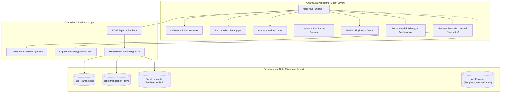

# DOKUMEN PERANCANGAN ANTARMUKA PENGGUNA (UI/UX) - COPY STAR KUBU
**Aplikasi:** Sistem Kasir, Percetakan Digital, dan Manajemen Ritel Toko  
**Versi Sistem:** v2.4 (Laravel 13 MVC & Single Page Application POS)  
**Studi Kasus:** Toko COPY STAR KUBU, Jln. Soeparto 1 Kubu, Kec. Kubu, Kab. Kubu Raya, Kalimantan Barat  

---

## 1. Analisis Kebutuhan & Profil Pengguna (User Persona)

Perancangan antarmuka aplikasi COPY STAR KUBU disusun menggunakan metode **User-Centered Design (UCD)** dengan memetakan 3 kelompok pengguna utama:

### Persona 1: Kasir Toko (Shift Operasional)
* **Peran & Karakter:** Petugas kasir harian yang bertugas melayani transaksi ritel, fotokopi, penjilidan, dan print berkas pada jam sibuk (pagi hingga sore hari).
* **Kendala Operasional:**
  * Penumpukan antrean pembeli saat melayani dokumen modul tebal atau naskah banyak halaman.
  * Risiko salah menghitung harga grosir lembaran jika dilakukan manual.
  * Kebutuhan kecepatan pencatatan tanpa bergantung penuh pada kursor mouse.
* **Solusi Antarmuka yang Diterapkan:**
  * **Shortcuts Keyboard (F1 - F12):** Kasir dapat mencari barcode (F1), membuka kalkulator print (F3), dan menyelesaikan pembayaran (F9) secara instan.
  * **Kalkulator Harga Bertingkat Otomatis (Tiered Pricing):** Jumlah lembar yang diinput langsung otomatis menyesuaikan tarif grosir sesuai aturan kuantitas.
  * **Tampilan Kembalian Monospace:** Nilai uang diterima dan kembalian ditampilkan dengan tipografi monospaced berukuran besar untuk mencegah kekeliruan perhitungan uang tunai.

---

### Persona 2: Pemilik Toko (Owner / Supervisor)
* **Peran & Karakter:** Penanggung jawab operasional yang membutuhkan pemantauan arus kas harian, persentase laba kotor, serta pencatatan piutang pelanggan.
* **Kendala Operasional:**
  * Pencatatan kasbon pelanggan atau instansi sering tidak tercatat rapi jika hanya menggunakan buku fisik.
  * Kebutuhan data rekapitulasi penjualan harian/bulanan untuk pembukuan atau pelaporan eksternal.
* **Solusi Antarmuka yang Diterapkan:**
  * **Buku Kasbon Digital:** Modul pelacakan piutang pelanggan dengan nominal utang, tanggal transaksi, status lunas/sebagian, dan pencatatan nama warga.
  * **Dasbor Ringkasan Penjualan:** Panel analitik berisi total omzet hari berjalan, estimasi margin kotor, dan daftar produk yang perlu dipesan ulang (restock).
  * **Ekspor Spreadsheet:** Fitur unduh laporan transaksi dalam format `.csv` berstandar Microsoft Excel.

---

### Persona 3: Pelanggan & Warga (Masyarakat, Guru, Instansi Desa)
* **Peran & Karakter:** Warga desa, aparat kantor desa, guru, dan siswa yang memerlukan jasa cetak dokumen, pas foto formal, atau perlengkapan ATK.
* **Kendala Operasional:**
  * Waktu tunggu cetak berkas dokumen panjang di lokasi toko saat mesin cetak sedang memproses pekerjaan lain.
* **Solusi Antarmuka yang Diterapkan:**
  * **Pemantauan Antrean Cetak Berkas:** Kasir dapat mencatat antrean dokumen masuk dari pelanggan dan memperbarui status berkas secara bertahap (Diterima $\rightarrow$ Sedang Dicetak $\rightarrow$ Siap Diambil).
  * **Portal Informasi Mandiri:** Antarmuka web ramah smartphone untuk memeriksa daftar harga layanan dan informasi operasional toko sebelum datang ke lokasi fisik.

---

## 2. Arsitektur Informasi (Information Architecture)

---

## 3. Sistem Desain (Design System Tokens)

### Palet Warna Fungsional
| Nama Token | Kode Warna | Penggunaan Antarmuka | Rasio Kontras |
| :--- | :--- | :--- | :--- |
| **Dark Slate Background** | `#0B0F19` | Latar belakang dasar tema gelap | 18.5:1 (Tinggi) |
| **Surface Card** | `#1F2937` | Wadah kartu modul, panel, dan dialog modal | 12.1:1 |
| **Amber Brand** | `#F59E0B` | Tombol aksi utama, identitas toko, sorotan | 8.2:1 |
| **Emerald Success** | `#10B981` | Tombol konfirmasi bayar, status lunas, ekspor | 7.4:1 |
| **Crimson Alert** | `#EF4444` | Kasbon jatuh tempo, peringatan batas stok | 6.8:1 |
| **Slate Border** | `#374151` | Garis pembatas tabel dan elemen formulir | 5.5:1 |

### Tipografi Antarmuka
1. **Font UI Utama (`Plus Jakarta Sans`):**
   - Digunakan untuk teks judul, navigasi, label formulir, dan tombol perintah agar nyaman dibaca pada resolusi layar monitor kasir.
2. **Font Numerik (`JetBrains Mono`):**
   - Digunakan pada seluruh angka nominal harga, jumlah kembalian, dan kode faktur untuk memastikan perataan digit tegak lurus (monospaced) dan meminimalkan kesalahan baca nominal uang.

### Standar Ergonomi Kasir
* **Ukuran Target Sentuh:** Semua tombol operasional utama memiliki tinggi minimal 48 piksel untuk kenyamanan pengoperasian pada layar monitor sentuh (touchscreen).
* **Umpan Balik Tindakan (Feedback):** Setiap aksi kasir (penambahan item, input barcode, perubahan kuantitas) memberikan indikasi visual dan audio yang jelas.
* **Pengatur Mode Tampilan:** Tersedia pilihan tema terang (Light Mode) dan tema gelap (Dark Mode) yang dapat disesuaikan dengan intensitas cahaya ruangan toko.

---

## 4. Evaluasi 10 Usability Heuristics Jakob Nielsen

1. **Visibilitas Status Sistem (Visibility of System Status):**
   - Nama kasir yang bertugas, status shift kerja, jam operasional lokal WIB, dan status koneksi database ditampilkan secara permanen pada bilah atas aplikasi.
2. **Kesesuaian Sistem dengan Dunia Nyata (Match between System and Real World):**
   - Penggunaan istilah operasional mengacu pada transaksi percetakan riil (*Rim*, *Jilid Mika*, *Bolak-Balik*, *Kasbon*, *Flexi per meter*).
3. **Kontrol dan Kebebasan Pengguna (User Control and Freedom):**
   - Kasir dapat membatalkan item keranjang, mereset sesi belanja, atau beralih antar-sesi transaksi pembeli lain tanpa kehilangan histori kerja.
4. **Konsistensi dan Standar (Consistency and Standards):**
   - Penempatan tombol konfirmasi di sudut kanan bawah, warna status hijau untuk pembayaran lunas, dan format mata uang Rupiah (`Rp xxx.xxx`) konsisten di seluruh halaman.
5. **Pencegahan Terjadinya Kesalahan (Error Prevention):**
   - Tombol penyelesaian transaksi dinonaktifkan secara otomatis apabila keranjang belanja masih dalam kondisi kosong.
6. **Mengenali Lebih Baik daripada Mengingat (Recognition Rather than Recall):**
   - Produk tersaji dalam bentuk kartu katalog visual berlabel harga jelas, sehingga kasir tidak diwajibkan menghafal seluruh kode SKU barang.
7. **Fleksibilitas dan Efisiensi Penggunaan (Flexibility and Efficiency of Use):**
   - Mendukung dua metode input: kasir pemula dapat menggunakan klik kursor/layar sentuh, sedangkan kasir berpengalaman dapat menggunakan kombinasi tombol keyboard cepat.
8. **Desain Bersih dan Efisien (Aesthetic and Minimalist Design):**
   - Tata letak antarmuka memprioritaskan ruang kerja transaksi kasir tanpa elemen dekorasi yang mengaburkan data penjualan.
9. **Membantu Pengguna Menangani Kesalahan (Help Users Recognize and Recover from Errors):**
   - Formulir transaksi memberikan pesan validasi yang jelas jika nominal uang pembayaran yang dimasukkan kasir kurang dari total tagihan belanja.
10. **Bantuan dan Dokumentasi (Help and Documentation):**
    - Tersedia modul panduan interaktif langsung di dalam aplikasi yang merinci petunjuk pengoperasian kasir, buku kasbon, kalkulator cetak, dan portal mandiri.
