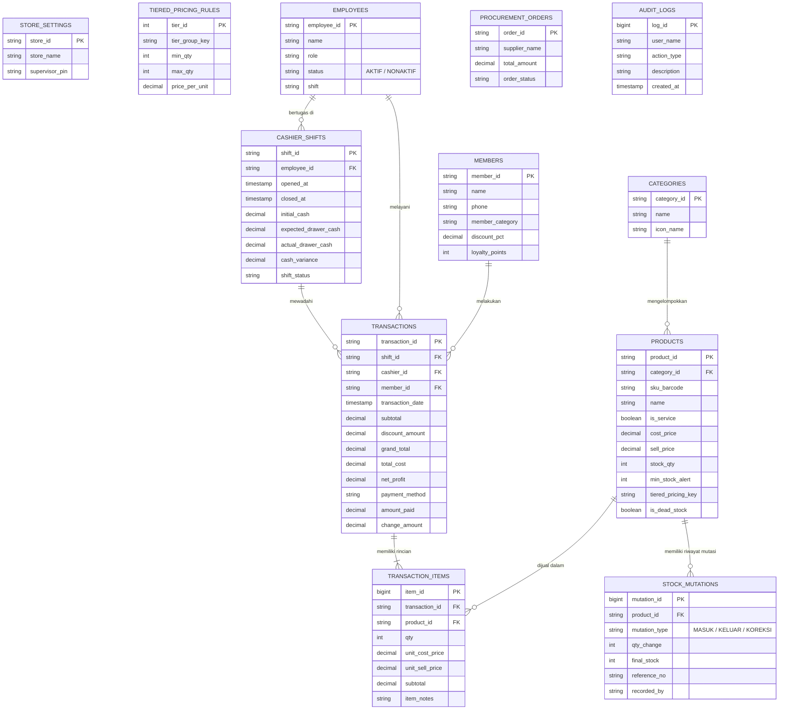

# PROPOSAL PENGEMBANGAN SISTEM INFORMASI KASIR & MANAJEMEN TOKO PINTAR
## "COPY STAR KUBU: DIGITAL PHOTOCOPY, PHOTO PRINTING & ATK"

---

### IDENTITAS PROYEK
* **Nama Sistem / Aplikasi:** COPY STAR KUBU Smart POS & Retail Intelligence
* **Nama Unit Usaha:** COPY STAR KUBU
* **Kontak WhatsApp Resmi Toko:** +62 812-5345-3440 (*Star Copy*)
* **Pemilik Usaha (Owner):** Theodorus Eldian
* **Lokasi Operasional:** Jln. Soeparto 1 Kubu, Desa Kubu, Kec. Kubu, Kabupaten Kubu Raya, Kalimantan Barat
* **Bidang Usaha:** Digital Photocopy, Photo Printing, Penjilidan & Alat Tulis Kantor (ATK)
* **Kategori Proyek:** Tugas Besar Pemrograman Web & Sistem Informasi Manajemen Ritel
* **Arsitektur Sistem:** Single Page Web Application (HTML5, Vanilla CSS3 Modern Glassmorphism, JavaScript ES6+ State Machine, LocalStorage Persistent Store, Relational SQL Architecture)

---

## BAB 1: PENDAHULUAN & LATAR BELAKANG

Usaha fotokopi dan toko alat tulis kantor (ATK) seperti **COPY STAR KUBU** memiliki karakteristik operasional yang sangat dinamis dan berbeda secara signifikan dengan minimarket atau toko kelontong biasa:

1. **Frekuensi Layanan Jasa yang Padat:** Selain menjual barang fisik (pulpen, kertas, buku), toko juga melayani jasa cetak digital, fotokopi, laminating, dan penjilidan.
2. **Kebutuhan Perhitungan Harga Bertingkat (*Tiered Pricing*):** Fotokopi dan cetak dokumen umumnya menerapkan diskon kuantitas (misal: 1–10 lembar Rp 500/lbr, sedangkan di atas 100 lembar Rp 250/lbr). Jika dihitung secara manual oleh kasir menggunakan kalkulator biasa, waktu transaksi menjadi lama dan rawan terjadi salah hitung.
3. **Antrean Bersilang (*Concurrent Wait*):** Pelanggan A seringkali sedang menunggu proses cetak 50 lembar, sementara Pelanggan B di belakangnya hanya ingin membeli 1 buah pulpen. Pada kasir konvensional, kasir tidak dapat melayani Pelanggan B tanpa menghapus atau menahan nota Pelanggan A.
4. **Resiko *Dead Stock* & Kehabisan Stok Mendadak:** Toko ATK memiliki ratusan varian barang kecil. Kertas ukuran F4 atau pulpen tertentu sering kehabisan stok tanpa terprediksi, sementara barang jenis lain mengendap berbulan-bulan (*dead stock*).

Oleh karena itu, sistem **COPY STAR KUBU** dibangun dengan paradigma **"Lebih dari Sekadar Kasir"**—sebuah sistem yang tidak hanya mencatat transaksi penjualan, tetapi juga membantu pengambilan keputusan (*Decision Support System*) bagi pemilik toko.

---

## BAB 2: KELEBIHAN SISTEM KASIR ATK "COPY STAR KUBU"

Dibandingkan pencatatan kasir konvensional, sistem ini menawarkan 6 keunggulan fundamental:

1. **Mempercepat Proses Transaksi:** Kasir tidak perlu menghitung total belanja dan kalkulasi fotokopi secara manual karena sistem langsung menghitung nominal secara otomatis dan instan.
2. **Mengurangi Kesalahan Perhitungan:** Total harga bertingkat, diskon member, dan uang kembalian dihitung dengan presisi algoritma sehingga risiko salah hitung diminimalisir hingga 0%.
3. **Pengelolaan Stok Lebih Mudah & Terstruktur:** Data persediaan barang dicatat, dipantau, dan diklasifikasikan statusnya (Aman, Menipis, atau *Dead Stock*) secara real-time.
4. **Data Transaksi Terorganisir:** Setiap nota penjualan tercatat rapi beserta nama kasir yang bertugas, metode pembayaran, hingga margin laba bersih yang dihasilkan.
5. **Menghemat Waktu:** Alur pelayanan kasir dirancang dengan tata letak satu layar, tombol uang cepat (*quick cash*), serta pintasan keyboard (*F2 search, F4 tab baru, F9 checkout*).
6. **Mudah Digunakan (*Intuitive UX*):** Antarmuka dibuat modern, bersih, ramah pengguna, dan didukung umpan balik audio digital saat scan barang.

---

## BAB 3: SPESIFIKASI DAN TINGKATAN FITUR SISTEM

Implementasi sistem dikelompokkan ke dalam 3 tingkatan sesuai rancangan kurikulum akademik:

### Level 1: Wajib (Standar Arahan Akademik)
* **Kasir Cepat Tata Letak Satu Layar (*Single Screen POS*):** Katalog barang di sebelah kiri dan keranjang belanja interaktif di sebelah kanan tanpa perlu berpindah-pindah halaman.
* **Multi-Sesi Kasir (Tab Browser):** Fitur tab transaksi simultan. Saat Pelanggan A menunggu fotokopi selesai, kasir dapat menekan tombol `+ Sesi Baru` untuk melayani Pelanggan B, lalu kembali ke tab Pelanggan A tanpa kehilangan item keranjang belanja.
* **Tombol Uang Cepat & Kembalian Otomatis:** Tombol instan (*Uang Pas, Rp 20.000, Rp 50.000, Rp 100.000*), perhitungan kembalian otomatis, dan cetak struk kasir termal.
* **Pencarian Instan & Filter Kategori:** Filter kategori (Print & Copy, Kertas & Buku, Alat Tulis, Jilid, Elektronik) dan pencarian real-time dengan tombol shortcut `F2`.
* **Manajemen Master Data Produk (CRUD):** Pencatatan produk lengkap dengan kategori, varian, harga beli (HPP), harga jual, batas minimum stok, dan harga grosir.
* **Manajemen Karyawan dengan Status Nonaktif:** Sesuai arahan dosen, saat staf berhenti/resign, status diubah menjadi **"Nonaktif"** (bukan dihapus permanen), agar rekam jejak historis nota transaksi masa lalu tidak rusak atau menghasilkan *foreign key error*.
* **Pengadaan Barang Otomatis (*Procurement/Restock*):** Modul penerimaan barang supplier yang secara otomatis menaikkan kuantitas stok fisik.
* **Autentikasi Pengguna & Portal Login (*Role-Based Login*):** Layar login terproteksi untuk membedakan hak akses Kasir (akses POS) dan Owner (akses penuh POS & Dashboard Manajemen), dilengkapi tombol akses uji coba cepat (*Quick Demo Login*).
* **Fitur Pemulihan Akun & Lupa Password (*Account Recovery*):** Mekanisme pemulihan akun bagi kasir/owner yang lupa kata sandi melalui verifikasi nomor WhatsApp/Email terdaftar dan kode OTP sebelum memperbarui password baru.
* **Dua Tampilan Berbasis Peran (*Role Separation*):** Layar Kasir (Front Office) dan Dashboard Owner (Back Office).

### Level 2: Nilai Plus (Fitur Pembeda Unggulan)
* **Peringatan & Prediksi Stok Cerdas:**
  - Peringatan stok menipis berdasarkan batas minimum (*threshold*).
  - Prediksi waktu habis stok (*stock depletion velocity*): contoh `"Pulpen Pilot G2 sisa 8 pcs, diprediksi habis dalam 4 hari lagi"`.
  - Rekomendasi restock otomatis ke distributor.
  - Kartu Stok (*Stock Ledger/Mutation Log*): riwayat lengkap barang masuk, barang keluar nota, dan penyesuaian.
  - Modul Stok Opname: komparasi hitungan fisik kasir vs hitungan sistem dengan deteksi selisih rugi/lebih.
  - Deteksi *Dead Stock*: identifikasi barang yang tidak terjual lebih dari 60 hari beserta rekomendasi paket diskon (*bundling*).
* **Kalkulator Khusus Fotokopi & Cetak Digital (*Tiered Pricing Engine*):**
  - Perhitungan harga bertingkat otomatis:
    - 1 – 10 lembar: Rp 500/lbr
    - 11 – 50 lembar: Rp 400/lbr
    - 51 – 100 lembar: Rp 350/lbr
    - > 100 lembar: Rp 250/lbr (Super Hemat)
  - Pilihan kertas: HVS 70g, HVS 80g, Buffalo, Glossy Foto.
  - Mode Simplex (1 Sisi) dan Duplex (Bolak-Balik).
  - Tambahan finishing: Jilid Lakban Mika, Spiral Kawat, Hardcover Skripsi, Laminating Panas.
* **Kasir Cerdas & Loyalitas Pelanggan:**
  - Rekomendasi silang (*AI Cross-Selling / Sering Dibeli Bersama*): jika pelanggan mencetak dokumen tugas, sistem otomatis merekomendasikan Map Clear Holder atau Klip Kertas.
  - Data Member & Poin: kategori Mahasiswa (diskon 5%) dan Mitra Kantor B2B (diskon 10%).
  - Metode Pembayaran Campuran (*Split Payment*): Tunai + QRIS.
* **Keamanan & Kontrol:**
  - Buka/Tutup shift kasir dengan audit uang laci dan deteksi selisih kas fisik.
  - Otorisasi PIN Supervisor / Owner (Default PIN / Password: `0000`) untuk membuka Dashboard Owner, pembatalan transaksi (*void*), atau diskon khusus.
  - Log Audit Aktivitas (*Security Activity Log*).

### Level 3: Wow Factor (Kecerdasan Buatan & Analitik Ritel)
* **Dashboard Analisis Owner:**
  - Grafik tren omzet dan margin laba bersih harian/mingguan (SVG interaktif dengan tooltip harga).
  - Heatmap Jam Ramai Kasir: visualisasi matriks intensitas layanan dari jam 08:00 hingga 21:00 untuk penyesuaian jadwal shift staf.
  - Kalender Penjualan Musiman (*Seasonal Event Impact*): penanda event seperti Tahun Ajaran Baru (+65%), Musim Skripsi (+80%), dan Periode Gajian (+40%).
* **Insight Cerdas Bahasa Manusia (*Natural Language Business Insights*):**
  > *"Penjualan Kertas Folio F4 melonjak 42% setiap Senin-Rabu pagi. Stok Kertas F4 tersisa 6 rim dan diprediksi habis dalam 2 hari. Segera lakukan pemesanan 25 rim ke supplier!"*
* **Asisten AI Chatbot Toko ("StarBot AI"):**
  - Owner dapat langsung mengetik atau menekan pertanyaan cepat:
    - *"Barang apa yang paling untung minggu ini?"*
    - *"Berapa omzet dan estimasi laba hari ini?"*
    - *"Siapa kasir dengan transaksi terbanyak?"*
    - *"Ada rekomendasi restock darurat?"*
  - StarBot langsung menganalisis data riil dan memberikan respon berbasis data terstruktur.
* **Struk Kasir Termal Realistik (58mm/80mm):** Pratinjau struk kertas termal lengkap dengan barcode/QR mock, tombol cetak langsung, unduh, dan bagikan tautan via WhatsApp.
* **Fitur Khas Ritel Desa (Local Village Business Specialization):**
  - **Buku Kasbon & Utang Piutang Warga Desa:**
    * Opsi pembayaran *Kasbon / Tempo* langsung di layar POS kasir dengan pencatatan nama warga, alamat/RT, kontak WhatsApp, tanggal jatuh tempo (misal: akhir bulan/gajian), serta uang muka (DP).
    * Buku piutang toko interaktif dengan 4 kartu metrik KPI (Total Piutang Berjalan, Jumlah Warga Belum Lunas, Kasbon Tertagih, dan Total Riwayat).
    * Pembayaran cicilan bertahap / pelunasan tunai maupun transfer dengan histori audit lengkap.
    * Tombol 1-klik pengingat tagihan santun via WhatsApp yang otomatis menyusun pesan ramah, rincian barang, dan sisa nominal.
  - **Antrean Berkas Cetak & Pas Foto Masuk via WhatsApp:**
    * Sistem antrean pesanan digital untuk file PDF, dokumen Word, berkas desa (KTP/KK/Surat Pengantar), dan pas foto yang dikirim warga via WhatsApp.
    * Alur status jelas: *⏳ Menunggu* ➔ *🖨️ Sedang Dicetak* ➔ *✅ Siap Diambil* ➔ *📦 Selesai / Masuk Kasir*.
    * Tombol 1-klik notifikasi WhatsApp ke pelanggan untuk memberi kabar bahwa berkas sudah beres dicetak dan siap diambil.
    * Tombol 1-klik *"Masuk Kasir (POS)"* yang otomatis memindahkan pesanan cetak ke keranjang kasir untuk langsung dibayar.

---

## BAB 4: PERANCANGAN BASIS DATA (ERD)

Sistem ini didasarkan pada skema relasional 12 entitas yang tertuang dalam file [schema.sql](file:///C:/Users/ASUS/.gemini/antigravity-ide/scratch/copy-star-kubu/schema.sql):

---

## BAB 5: SKENARIO DEMO PENGUJIAN (UNTUK PRESENTASI DOSEN)

Untuk membuktikan alur sistem **Input → Proses → Output** secara terintegrasi di hadapan dosen penguji, lakukan demonstrasi melalui 5 tahapan berurutan:

1. **Tahap 1: Pengadaan & Barang Masuk (Restock)**
   - Masuk ke **Dashboard Owner** → menu **Stok & Katalog Barang**.
   - Tunjukkan barang *"Kertas HVS F4"* yang berstatus **Kritis (Stok 6 rim)**.
   - Klik tombol `+ Pengadaan / Restock`, tambahkan 20 rim.
   - Buka modal **Kartu Stok**, tunjukkan pencatatan mutasi otomatis dengan tipe `MASUK`.

2. **Tahap 2: Layanan Kasir Multi-Sesi Simultan (Pelanggan A & B)**
   - Beralih ke **Layar Kasir (POS)**.
   - Sesi 1 (Pelanggan #101): Buka **Kalkulator Print & Fotokopi**, masukkan 50 lembar fotokopi + Jilid Lakban Mika. Tunjukkan perhitungan harga bertingkat otomatis (*Rp 400/lbr, bukan Rp 500*). Masukkan ke keranjang.
   - Pelanggan #101 meminta waktu untuk mengecek dokumen. Kasir menekan `+ Sesi Baru (F4)`.
   - Muncul tab **Pelanggan #102**. Kasir melayani Pelanggan #102 yang membeli pulpen dan buku tulis secara instan.
   - Kasir kembali mengklik tab **Pelanggan #101**—tunjukkan bahwa data pesanan 50 lembar fotokopi tidak hilang sama sekali!

3. **Tahap 3: Fitur Cerdas Kasir (Cross-Selling, Diskon Member, & Quick Cash)**
   - Pada keranjang Pelanggan #101, tunjukkan kotak rekomendasi AI: *"Sering Dibeli Bersama: Map Clear Holder & Klip Kertas"*. Klik untuk menambahkannya.
   - Pilih Member *"Rian Ardiansyah (Mahasiswa)"* → sistem langsung memotong diskon 5%.
   - Tekan tombol cepat `Rp 50.000` → kembalian terhitung seketika.
   - Klik `BAYAR SEKARANG (F9)` → struk kasir termal langsung muncul di layar beserta opsi kirim WhatsApp.

4. **Tahap 4: Pengurangan Stok & Otomatisasi Kartu Stok**
   - Tunjukkan bahwa stok barang fisik otomatis berkurang di database, tercatat di Kartu Stok sebagai `KELUAR`, dan pendapatan masuk ke saldo shift kasir.

5. **Tahap 5: Eksekutif Dashboard & Tanya StarBot AI**
   - Kembali ke **Dashboard Owner**.
   - Tunjukkan metrik laba bersih, grafik omzet harian yang naik, dan matriks Heatmap jam sibuk.
   - Buka **StarBot AI Toko** dan klik pertanyaan:
     - *"Barang apa yang paling untung minggu ini?"*
     - *"Berapa omzet dan estimasi laba hari ini?"*
   - Tunjukkan bagaimana asisten AI menjawab langsung dengan kalkulasi margin bisnis nyata.

6. **Tahap 6: Portal Order Pelanggan Mandiri & Antrean WhatsApp Real-Time**
   - Buka **Portal Order Pelanggan** (dapat diakses mandiri via `Portal Order Pelanggan - COPY STAR KUBU.bat`, via URL `?mode=customer`, atau klik tombol akses pelanggan di layar masuk).
   - Tunjukkan bahwa pelanggan memiliki tampilan khusus yang terisolasi aman tanpa akses ke data rahasia toko (tidak bisa melihat laci kasir, pembukuan kasbon utang piutang, maupun analisa laba bersih).
   - Pilih layanan cetak (misal: Fotokopi B/W atau Print Skripsi), tentukan jumlah lembar, jenis kertas, dan finishing. Tunjukkan kalkulasi tarif otomatis.
   - Klik `Kirim Pesanan ke WhatsApp & Ambil Antrean` → Tiket Antrean Digital diterbitkan (contoh: `WA-205`), pesan terformat otomatis tersambung ke WhatsApp toko (`+62 812-5345-3440`), dan pesanan seketika masuk ke tab **Antrean Order** kasir secara real-time. Kasir dapat langsung mentransfernya ke kasir dengan 1 tombol (`🛒 Ke Kasir`).

7. **Tahap 7: Demonstrasi 5 Fitur Unggulan Spesial Copy Star Kubu**
   - **Fitur 1: Studio Pas Foto Kilat (Crop & Ganti Background Merah/Biru):**
     - Klik tombol `📸 Pas Foto Kilat` di bagian atas katalog kasir POS.
     - Unggah foto pelanggan, sesuaikan zoom dan drag posisi wajah agar presisi di oval panduan.
     - Pilih ukuran pas foto resmi (`3x4`, `4x6`, atau `2x3`).
     - Ganti warna latar belakang dalam 1-klik (`Merah Kemendagri` ganjil, `Biru KTP` genap, atau `Putih`).
     - Pratinjau susunan **Paket Campur 4R (8 foto dalam 1 lembar)**, unduh file atau tekan tombol `🖨️ Cetak Lembar Foto` & `🛒 Masukkan Kasir (Rp 10.000)`.
   - **Fitur 2: Panggilan Suara Antrean Otomatis (Voice Queue Caller):**
     - Pada kartu antrean berstatus *"Siap Diambil"*, tekan tombol `📢 Panggil`.
     - Sistem langsung membunyikan lonceng dan memanggil nomor serta nama pelanggan menggunakan suara vokal Bahasa Indonesia yang jernih melalui Web Speech API browser (`"Panggilan antrean nomor W A 001. Atas nama Budi Santoso..."`).
   - **Fitur 3: Upload Berkas & Auto-Counter Halaman PDF:**
     - Pada Portal Pelanggan atau di Kalkulator Print Kasir (`F3`), seret file PDF (misal: berkas 35 halaman).
     - Tanpa library luar, sistem membaca struktur biner file dalam hitungan milidetik dan otomatis mengisi jumlah lembar menjadi 35 serta menghitung total biaya bertingkat seketika.
   - **Fitur 6: Cadangkan & Pulihkan Database Toko 1-Klik (Backup & Restore JSON):**
     - Klik tombol `💾 Backup Toko` di header.
     - Klik `Unduh File Cadangan JSON` untuk mengekspor seluruh transaksi, kasbon, stok, dan antrean.
     - Uji coba pemulihan dengan memilih file backup, pilih `Gabungkan (Merge)` atau `Timpa Total (Replace)` untuk mengembalikan data toko dengan aman.
   - **Fitur 7: Kalkulator Khusus Spanduk / Banner & Undangan Acara:**
     - Klik tombol `📐 Banner & Undangan` di bilah kasir POS.
     - Tab Banner: Masukkan panjang 3 meter x lebar 1 meter, pilih bahan *Flexi Korchin*, finishing mata ayam, dan stand rollup → sistem otomatis menghitung luas m² dan biaya total.
     - Tab Undangan: Masukkan jumlah 300 pcs model *Lipat 2 Art Carton* → sistem otomatis memberikan diskon kuantiti 5% serta menghitung opsi DP 50%.
     - Tekan `🛒 Masukkan ke Kasir POS` untuk langsung memproses transaksi di meja kasir.

---

## BAB 6: KESIMPULAN

Sistem Kasir & Manajemen Ritel **COPY STAR KUBU** berhasil mentransformasikan operasional toko fotokopi dan ATK dari pencatatan manual yang lambat menjadi sistem digital terintegrasi berkecepatan tinggi. Dengan fitur multi-sesi, kalkulator harga bertingkat, kepatuhan integritas data karyawan (status nonaktif), manajemen kartu stok, portal order pelanggan mandiri terhubung WhatsApp, dan asisten AI StarBot, sistem ini memenuhi seluruh ekspektasi penilaian dosen dari Level 1 (Wajib), Level 2 (Nilai Plus), hingga Level 3 (Wow Factor).
